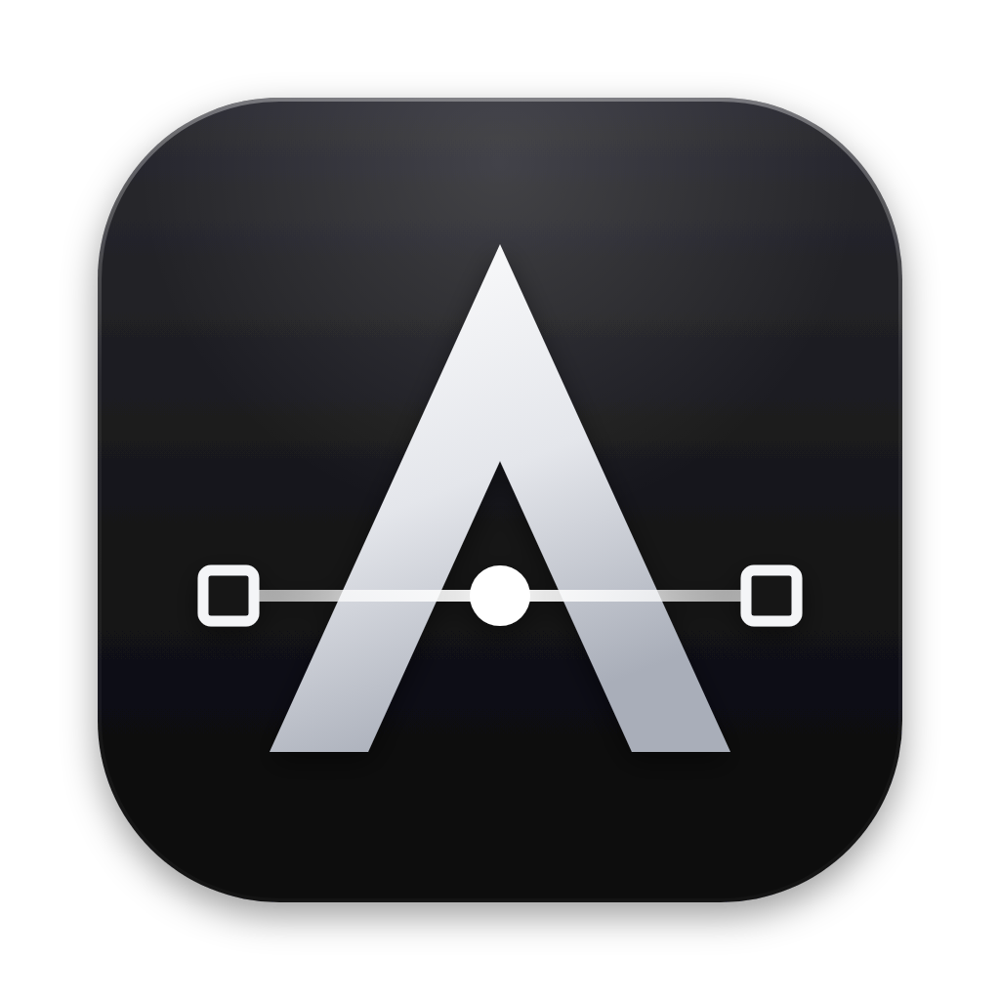
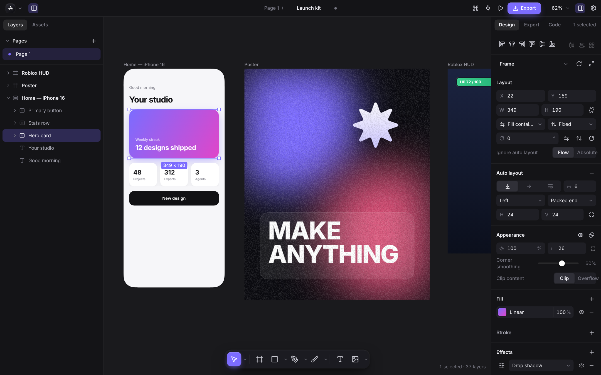
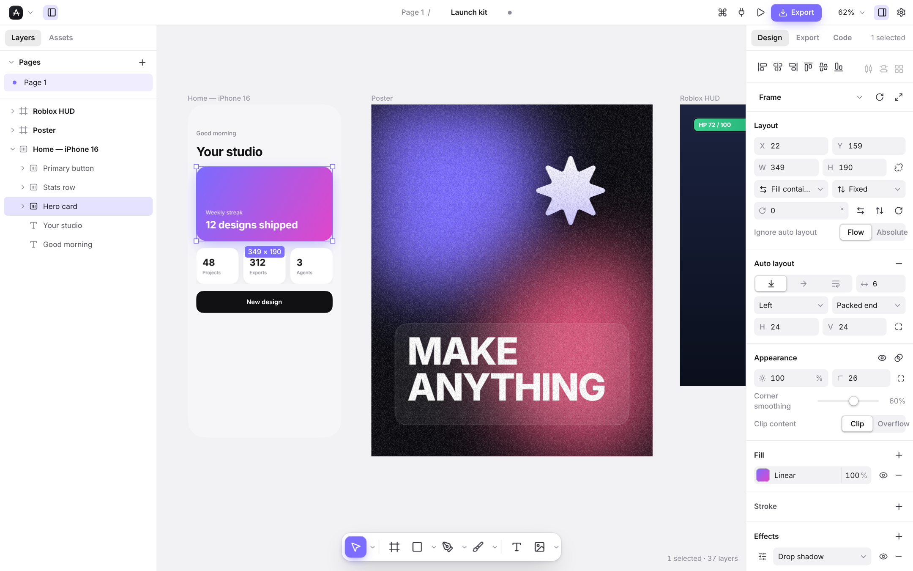

<div align="center">



# Alt

**A free, open-source design studio for every kind of 2D art.**
Figma-style interface · vector + raster + pixel tools · built-in MCP server for AI agents ·
export to HTML, React, SwiftUI, Flutter, Compose, Roblox Studio, Godot, Unity and more.

macOS · Windows · Linux — x64, ARM64 (Apple Silicon, Windows on ARM, Raspberry Pi 64-bit), ia32 and ARMv7



</div>

---

## Why Alt?

| | |
|---|---|
| **Familiar** | A Figma-style workspace: layers & pages on the left, a design inspector on the right, a floating tool dock, frames, auto layout, components, booleans, constraints and smart guides. |
| **More than UI** | Pressure-sensitive vector brushes, raster painting, spray, eraser, flood fill, a pixel-art pencil with symmetry, pattern & noise fills, glows, grain, adjustments and background blur. |
| **Agent-ready** | A Model Context Protocol server ships inside the app. Claude Code, Claude Desktop, Cursor, VS Code and any MCP client can read and edit your design, take screenshots and export code — every change is undoable. |
| **Exports everywhere** | PNG/JPG/WebP, SVG, PDF, HTML & CSS, React (+Tailwind), SwiftUI, Flutter, Jetpack Compose, Android VectorDrawable, **Roblox Studio `.rbxmx` + Luau**, Godot `.tscn`, Unity UI Toolkit, JSON, design tokens and CSS variables. |
| **Yours** | MIT-licensed, offline, no account. Documents are plain JSON (`.alt`). Themes, accent colour, UI scale, toolbar position and every keyboard shortcut are customisable — and a script console lets you automate the rest. |

## Features

### Design
- Frames with device presets (iPhone, Android, iPad, desktop, social, print, Roblox), clip content, layout grids
- **Auto layout** — horizontal / vertical / wrap, gap, per-side padding, alignment, space-between, hug / fill / fixed sizing, drag-to-reorder on canvas
- Constraints (left, right, centre, scale, stretch) when resizing frames
- Rectangles with per-corner radii and **iOS-style corner smoothing (squircles)**, ellipses with arcs & donuts, polygons, stars, lines & arrows (arrow, triangle, circle, square, diamond, bar caps), spirals and a shape library
- Pen tool with bezier handles and **vector edit mode** (move points & handles, add points on segments, toggle smooth/corner, delete)
- **Live boolean groups** — union, subtract, intersect, exclude — plus flatten
- Masks, groups, components, rich layer tree with drag & drop, lock/hide, rename
- Text with auto width / auto height / fixed boxes, weights, italics, line height, letter & paragraph spacing, alignment, decoration, case, text styles and local font discovery
- Smart guides & snapping (objects, pixel grid, grid, guides), rulers (drag out guides), Alt-hover measurements
- Align, distribute, tidy up, repeat in a grid, **radial repeat**, flip, rotate, scale tool (scales strokes, type, radii and effects with the geometry)

### Paint & draw (beyond Figma)
- **Vector brushes**: pen, ink, marker, highlighter and calligraphy — pressure-sensitive (pen tablets) with smoothing & taper
- **Raster paint layers**: soft brush with hardness / opacity / flow, spray, eraser and tolerance-based **flood fill**
- **Pixel art**: one click creates a 32×32 sprite with a pixel grid and nearest-neighbour rendering
- **Symmetry** for every brush: mirror X, Y, X+Y or radial mandala mode
- Pencil tool with automatic curve fitting

### Paints & effects
- Solid, linear, radial, angular (conic) and **diamond** gradients with on-canvas handles
- Image fills (fill, fit, crop, tile, stretch) with exposure / contrast / saturation / temperature / tint / highlights / shadows
- **Pattern fills** (dots, grid, lines, diagonal, checker, cross, waves, zigzag, triangles, hexagons) and **noise fills**
- Drop & inner shadows with spread, **outer glow**, layer blur, **background blur (glass)**, **grain**, colour adjustments
- All 16 blend modes plus plus-lighter, per layer and per paint
- Inside / centre / outside strokes, dashes, caps and joins

### Workflow
- Command palette (`⌘K` / `Ctrl+K`) for every action, tool, template and layer
- Infinite undo / redo, copy / paste between documents (and as SVG or PNG), drag & drop of images and SVGs, SVG paste & import
- Live **Code** inspector — see HTML, React, SwiftUI, Flutter, Roblox Luau… for the selection as you design
- **Script console** (`⌥⌘J` / `Ctrl+Alt+J`) — automate anything with JavaScript against the same document API agents use, and save scripts as your own mini-plugins
- Present mode for frames, outline (wireframe) mode, crash recovery, recent files
- Dark & light themes, 8 accent colours (or any colour), UI scaling, remappable shortcuts

<details>
<summary>Light theme</summary>



</details>

## Download

Grab the latest build from [Releases](https://github.com/nox-abc/alt/releases).

| Platform | Architectures | Formats |
|---|---|---|
| macOS 12+ | Apple Silicon (arm64), Intel (x64) | `.dmg`, `.zip` |
| Windows 10/11 | x64, arm64, ia32 | installer `.exe`, `.zip` |
| Linux | x64, arm64, armv7l | `AppImage`, `.deb`, `.rpm`, `.tar.gz` |

> **macOS:** builds are ad-hoc signed, not notarised. On first launch right-click the app → **Open**, or run `xattr -cr /Applications/Alt.app`.

There is also a web build (`npm run build:web`) that runs in any modern browser — everything except the MCP server works there.

## Connect an AI agent (MCP)

Alt runs a local MCP server at `http://127.0.0.1:7331/mcp` while it is open (Settings → AI agents shows the exact URL and copy-ready configs).

```bash
# Claude Code
claude mcp add --transport http alt http://127.0.0.1:7331/mcp
```

For clients that only speak stdio (e.g. Claude Desktop) Alt ships a tiny bridge that runs on its own executable — no Node.js required. See **[docs/MCP.md](docs/MCP.md)** for Claude Desktop, Cursor, VS Code and Windsurf configs, the full tool reference and security notes.

Tools include `get_document`, `get_tree`, `find_nodes`, `create_nodes` (whole nested designs in one call), `update_nodes`, `group_nodes` (incl. booleans), `set_auto_layout`, `import_svg`, `screenshot`, `export` (any format above), `manage_pages`, `undo`/`redo` and an opt-in `run_script`.

## Build from source

Requires Node.js 20+.

```bash
npm install
npm run dev          # Electron app with hot reload
npm run dev:web      # browser-only version at http://localhost:5173
npm test             # unit tests (vitest)
npm run typecheck
```

Package installers (outputs to `release/`):

```bash
npm run dist:mac     # dmg + zip, x64 and arm64
npm run dist:win     # nsis + zip, x64, ia32 and arm64
npm run dist:linux   # AppImage, deb, rpm, tar.gz — x64, arm64 and armv7l
```

Tagging a commit `v*` runs `.github/workflows/release.yml`, which builds every platform/architecture on GitHub Actions and attaches the artifacts to a GitHub Release.

## Keyboard shortcuts (defaults)

| Tools | | Edit | | View | |
|---|---|---|---|---|---|
| Move | `V` | Undo / redo | `⌘Z` / `⇧⌘Z` | Command palette | `⌘K` |
| Frame | `F` / `A` | Duplicate | `⌘D` | Zoom to fit | `⇧1` |
| Rectangle / Ellipse | `R` / `O` | Group / ungroup | `⌘G` / `⇧⌘G` | Zoom to selection | `⇧2` |
| Polygon / Star | `Y` / `⇧Y` | Frame selection | `⌥⌘G` | Zoom 100% | `⇧0` |
| Line / Arrow | `L` / `⇧L` | Auto layout | `⇧A` | Rulers | `⇧R` |
| Pen / Pencil | `P` / `⇧P` | Boolean union / subtract | `⌥⌘U` / `⌥⌘S` | Outline mode | `⌘Y` |
| Vector brush / Paint | `B` / `⇧B` | Flatten | `⌘E` | Hide UI | `⌘\` |
| Eraser / Bucket / Pixel | `E` / `G` / `X` | Mask | `⌥⌘M` | Present | `⌥⌘↩` |
| Text | `T` | Copy as SVG / PNG | `⇧⌘C` / `⌥⌘C` | Settings | `⌘,` |
| Eyedropper / Hand | `I` / `H` (or Space) | Opacity | `1`…`0` | Export | `⇧⌘E` |

On Windows and Linux `⌘` is `Ctrl` and `⌥` is `Alt`. Every shortcut can be remapped in **Settings → Shortcuts**.

## Architecture

```
src/core      document model, geometry, path maths, booleans (paper.js), text & auto layout, undoable store (zustand + immer)
src/render    Canvas 2D renderer: paints, gradients, patterns, effects, masks, text, bitmaps; hit testing; rasteriser
src/editor    viewport, tools (select, shapes, pen/vector edit, pencil, brushes, raster paint, pixel, text…), snapping, overlay, actions & shortcuts, clipboard, files
src/ui        React interface: title bar, layers/assets, design inspector, colour picker, toolbar, command palette, settings, export
src/export    exporters (one module per target) behind a small registry
src/import    SVG importer
src/api       MCP tool schemas + renderer-side handlers
electron      main process, preload bridge, MCP Streamable-HTTP server
mcp           stdio ⇄ HTTP bridge for stdio-only MCP clients
```

The document is a flat map of nodes with parent-relative transforms; every mutation goes through one `mutate()` call that records history, so the UI, keyboard shortcuts, scripts and MCP clients all share the same undo stack.

## Contributing

Issues and pull requests are welcome. Please run `npm run typecheck && npm test` before opening a PR.

## License

[MIT](LICENSE) © Alt contributors. Icons: [Lucide](https://lucide.dev) (ISC). Boolean geometry: [paper.js](http://paperjs.org) (MIT). Brush strokes: [perfect-freehand](https://github.com/steveruizok/perfect-freehand) (MIT). Fonts: Inter & JetBrains Mono (OFL).
